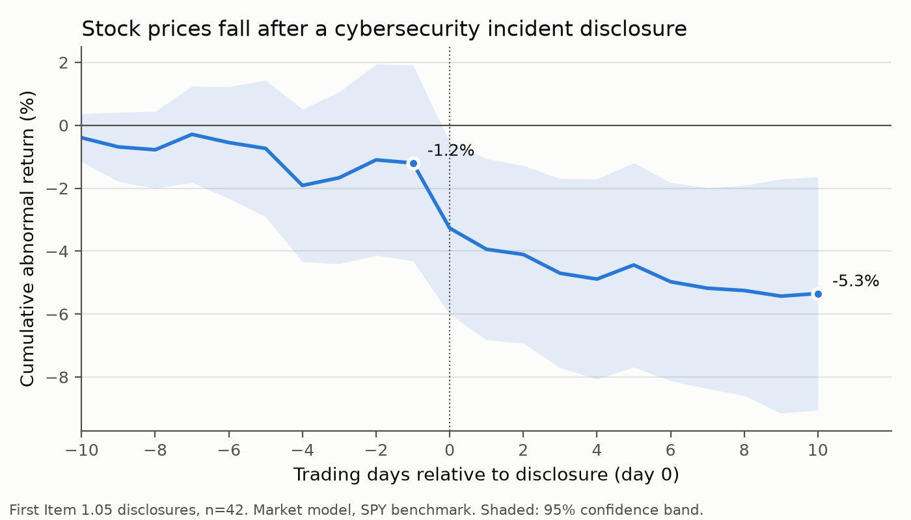

# Cyber Breach Disclosures and Market Reaction

[](https://github.com/vaidehidoye/cyber-disclosure-event-study/actions/workflows/tests.yml)

How do stock markets react when firms disclose a material cybersecurity incident under the SEC's
Form 8-K **Item 1.05** rule (mandatory since 18 December 2023)? And does the *content* of a
disclosure explain the size of the reaction?

📄 **Research note:** [`paper/research_note.md`](paper/research_note.md)

## Key findings



- Firms lose on average **2.7% of market value** (median 2.0%) in the two trading days after an
  Item 1.05 disclosure (n = 42, p < 0.001 on t, BMP and Wilcoxon tests); **81%** of firms decline.
- There is **no significant drift before** the filing (days −5 to −2: −0.6%, p = 0.62), so the 8-K is genuinely new information.
- Incidents that were **already public** through an earlier voluntary 8-K show **no reaction** when
  later re-filed under Item 1.05 (−0.4%, p = 0.82, n = 7).
- The result is robust to a Fama-French 3-factor model, alternative windows, winsorizing, dropping
  small firms, and a placebo test (0 of 200 random-date samples are as negative).
- Keyword and dictionary measures of incident type and disclosure language do **not** significantly
  explain *which* firms fall more, though with 42 events the test has limited power.

| Window | Mean CAR | Median | % negative | p (BMP) |
|---|---|---|---|---|
| [−5, −2] | −0.55% | −0.48% | 57% | 0.62 |
| **[0, +1]** | **−2.74%** | **−1.98%** | **81%** | **0.0003** |
| [0, +5] | −3.24% | −2.16% | 79% | 0.0008 |
| [0, +10] | −4.15% | −3.34% | 74% | 0.010 |

Full tables: [`results/`](results/).

## Pipeline

| Step | Module | What it does |
|---|---|---|
| 1 | `src/edgar.py` | Full-text search of SEC EDGAR for 8-K filings mentioning Item 1.05 |
| 2 | `src/events.py` | One row per incident: first disclosure, SEC acceptance time, ticker, Item 1.05 text, follow-ups, flags for earlier voluntary disclosure |
| 3 | `src/prices.py` | Daily returns and dollar volume (Yahoo Finance), SPY benchmark, Fama-French factors |
| 4 | `src/features.py` | Keyword flags (ransomware, data theft, disruption, ...), Loughran-McDonald word shares, industry, size proxy |
| 5 | `notebooks/llm_extraction.ipynb` | *Optional, free on Google Colab:* an open LLM (Qwen 2.5 3B) extracts structured features from each disclosure |
| 6 | `src/analysis.py` | Event study (CARs + significance tests), figures, cross-sectional regressions, robustness, LLM validation |

`src/event_study.py` is the reusable engine (market / FF3 models, after-close timing,
Boehmer-Musumeci-Poulsen and Wilcoxon tests), covered by unit tests in `tests/`.

## Reproduce

Everything is free: no paid data or API keys.

```bash
make setup                       # Python 3.12 virtual env + dependencies
cp .env.example .env             # add your name and email (required by the SEC)
make all                         # download data and run the analysis (~3 minutes)
make test                        # unit tests
```

Optional LLM features: open `notebooks/llm_extraction.ipynb` in
[Google Colab](https://colab.research.google.com/github/vaidehidoye/cyber-disclosure-event-study/blob/main/notebooks/llm_extraction.ipynb),
choose a T4 GPU runtime, run all cells, save the downloaded `llm_features.csv` to `data/processed/`
and rerun `make analysis`.

## Data sources

- **SEC EDGAR** full-text search and filing archives: event dates, acceptance times, disclosure text
- **Yahoo Finance** via `yfinance`: adjusted daily prices and volume
- **Kenneth French Data Library**: daily Fama-French factors
- **Loughran-McDonald** master dictionary (bundled with `pysentiment2`)

## Limitations

Small sample (Item 1.05 has only existed since December 2023); firms delisted since their incident
are missing from Yahoo Finance (survivorship); after May 2024 SEC guidance, many firms report
incidents voluntarily under Item 8.01 instead, which this sample does not cover. See the research note.
