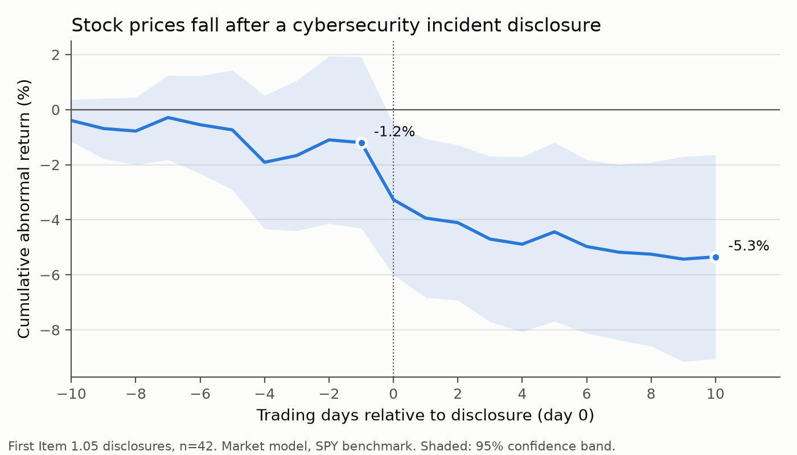
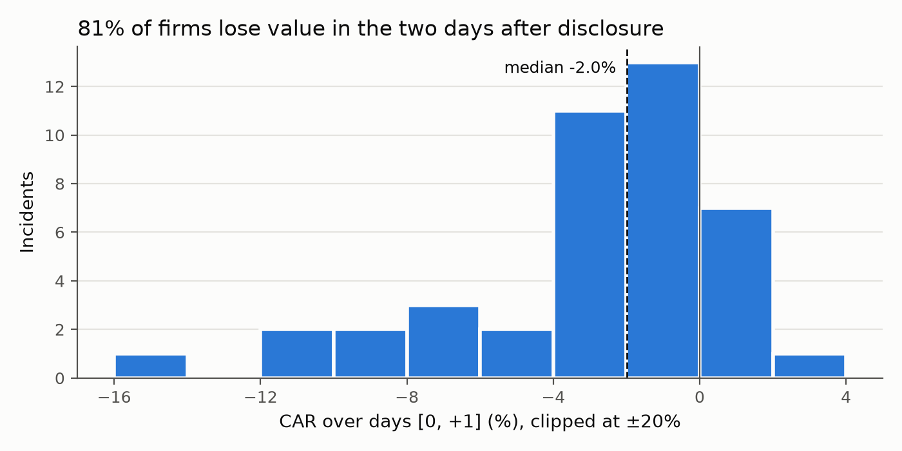

# Is the News in the Filing? Market Reactions to Mandatory Cybersecurity Incident Disclosures

**Vaidehi Doye** · Research note · November 2026

*Code and data: <https://github.com/vaidehidoye/cyber-disclosure-event-study>*

## Abstract

Since December 2023, U.S. public companies must disclose material cybersecurity incidents within
four business days on Form 8-K under the new Item 1.05. Using the full population of Item 1.05
filings through October 2026, I study how equity markets react to these mandatory disclosures.
Firms lose on average 2.7% of market value (median 2.0%) over the two trading days after a
first Item 1.05 disclosure, and 81% of firms decline. The reaction is absent before the filing,
robust to the choice of benchmark model and event window, and far outside the distribution of
placebo samples built from random dates. By contrast, incidents that firms had *already*
disclosed voluntarily and later re-filed under Item 1.05 produce no reaction, which suggests the
market responds to new information rather than to the filing format. Text-based measures of
incident type and disclosure language do not significantly explain which firms are hit hardest,
a question I outline how to pursue with large-language-model feature extraction and a larger sample.

## 1. Motivation

Cyberattacks are now a first-order business risk, yet investors have historically learned about
them through press reports, leaks or delayed voluntary statements. In July 2023 the SEC adopted
rules requiring registrants to disclose a cybersecurity incident on Form 8-K within four business
days of determining that it is material (Release No. 33-11216). The disclosure requirement, Item 1.05,
became effective on 18 December 2023 for most registrants (15 June 2024 for smaller reporting companies).

The rule raises an information-systems question with policy relevance: **does mandatory, rapid
disclosure deliver information that investors price, or does it formalize what markets already
know?** If the filings carry news, the rule improves price discovery about cyber risk; if they do
not, the compliance costs and the risk of tipping off attackers that critics raised are harder to justify.

This note offers first evidence on three questions:

1. How large is the market reaction to a first Item 1.05 disclosure?
2. Is the reaction driven by the information itself, or by the formal filing?
3. Do observable features of the incident and of the disclosure text explain the size of the reaction?

## 2. Related literature

A long event-study literature documents negative but heterogeneous stock price reactions to publicly
reported security breaches. Campbell, Gordon, Loeb and Zhou (2003) find significant negative
reactions mainly for breaches involving unauthorized access to confidential data. Cavusoglu,
Mishra and Raghunathan (2004) find that breached firms lose value while security vendors gain.
Acquisti, Friedman and Telang (2006) show that privacy breaches have a negative but short-lived
effect. Kamiya, Kang, Kim, Milidonis and Stulz (2021) find significant shareholder losses from
successful cyberattacks, concentrated in attacks that compromise personal financial information.

These studies date events by media reports or data-breach databases, where it is hard to pin down
exactly when investors learned of an incident. Item 1.05 offers a cleaner setting: a standardized,
time-stamped regulatory disclosure. The rule is also new enough that its market consequences are
largely unstudied.

## 3. Data

**Events.** I query the SEC EDGAR full-text search for all Form 8-K and 8-K/A filings from
18 December 2023 to 11 November 2026 that contain the phrase "Item 1.05". Of 97 matching filings,
85 are filed under Item 1.05. The remainder only mention the item in passing, for example in merger agreements.

I group filings into incidents. An original 8-K starts a new incident unless the same firm filed
an Item 1.05 8-K in the preceding 60 days, in which case it is a follow-up. Amendments (8-K/A) are
attached to the most recent incident within a year. This yields **57 incidents**, 21 of which have at
least one follow-up filing. I drop one amendment whose original is not in the data.

**Timing.** For each incident I scrape the SEC acceptance timestamp from the filing index. Most
filings arrive after the market closes at 4 pm Eastern (76% in the final sample). Day 0 is therefore
the first trading day on which the market could react: the filing date if accepted before the close,
otherwise the next trading day. Using the calendar filing date instead would misdate most events.

**Earlier voluntary disclosure.** Seven incidents open with language such as "As previously disclosed
in a Current Report on Form 8-K…": the firm had already reported the incident, often under Item 8.01
or 7.01, before re-filing it under Item 1.05. For these, the Item 1.05 date is *not* when investors
first learned of the incident. I exclude them from the main sample and use them as a comparison group.

**Prices.** Daily dividend- and split-adjusted returns and dollar volume come from Yahoo Finance,
with the SPDR S&P 500 ETF (SPY) as the market benchmark. Daily Fama-French factors come from Kenneth
French's data library. Of the 50 first disclosures, one firm has no listed equity, four have been
delisted and lack Yahoo data, and three have corrupted price series. Those three (Meta Materials,
Zoomcar, Wytec) show repeated daily moves beyond ±50% caused by reverse splits that are missing from
Yahoo's adjustments. I exclude any stock with more than three such days. **The final sample has 42 incidents.**

**Text features.** From the Item 1.05 section of each filing (with legal boilerplate on forward-looking
statements removed; median 303 words) I build:

- keyword indicators for ransomware, data exfiltration or personal data, operational disruption,
  nation-state attribution, third-party vendor involvement, and law-enforcement contact;
- whether the firm states that it has *not yet determined* whether the impact is material;
- Loughran-McDonald (2011) negative, uncertainty and litigious word shares; and
- log disclosure length.

As a size and liquidity proxy, I use log average daily dollar volume over the estimation window.

## 4. Method

I use a standard short-window event study (MacKinlay, 1997). Normal returns are estimated with a
market model, $R_{it} = \alpha_i + \beta_i R_{mt} + \varepsilon_{it}$, over trading days [−250, −30]
relative to day 0, requiring at least 120 observations. Abnormal returns are
$AR_{it} = R_{it} - \hat\alpha_i - \hat\beta_i R_{mt}$, and cumulative abnormal returns (CARs) sum
them over a window. The main window is [0, +1].

I test whether the mean CAR is zero in three ways: a cross-sectional t-test; the Boehmer, Musumeci and
Poulsen (1991) test on standardized CARs, which is robust to event-induced increases in volatility; and a
non-parametric Wilcoxon signed-rank test. Standardization uses each firm's estimation-window residual
variance, including the prediction error from estimating the model parameters.

To explain variation across firms, I regress CAR[0, +1] (in %, winsorized at 5%/95%) on the text features,
using HC3 heteroskedasticity-robust standard errors given the small sample.

## 5. Results

### 5.1 The average reaction

| Window | n | Mean CAR | Median CAR | % negative | t | p (t) | p (BMP) | p (Wilcoxon) |
|---|---|---|---|---|---|---|---|---|
| [−5, −2] | 42 | −0.55% | −0.48% | 57% | −0.50 | 0.62 | 0.62 | 0.93 |
| [−1, +1] | 42 | −2.84% | −1.70% | 76% | −4.54 | <0.001 | <0.001 | <0.001 |
| [0, 0] | 42 | −2.07% | −1.22% | 81% | −3.99 | <0.001 | <0.001 | <0.001 |
| **[0, +1]** | **42** | **−2.74%** | **−1.98%** | **81%** | **−4.76** | **<0.001** | **<0.001** | **<0.001** |
| [0, +5] | 42 | −3.24% | −2.16% | 79% | −3.63 | <0.001 | <0.001 | <0.001 |
| [0, +10] | 42 | −4.15% | −3.34% | 74% | −2.90 | 0.006 | 0.010 | 0.001 |

The reaction is concentrated on day 0 (−2.1%) and grows to about −4% over the following two weeks.
The pre-event window [−5, −2] is small and insignificant, so there is no evidence of widespread
leakage before the filing. Figure 1 shows the cumulative path; Figure 2 shows that the reaction is broad-based
rather than driven by a few outliers. The largest declines are F5 (−14.3%), B. Riley Financial (−11.5%)
and UFP Technologies (−10.5%).

*Figure 1. Cumulative average abnormal return around first Item 1.05 disclosures, with a 95% confidence band.*

*Figure 2. Distribution of CAR[0, +1] across incidents.*

### 5.2 Is the news in the filing?

If investors respond to the information, re-filing an already public incident under Item 1.05 should
move prices little. For the seven incidents first disclosed voluntarily, the CAR[0, +1] at the Item 1.05
date is −0.35% (p = 0.82). The group is small, so this is suggestive rather than conclusive. Still, the
contrast with −2.74% for first disclosures is consistent with markets pricing the *news* of an incident,
not the regulatory label.

### 5.3 Robustness

| Specification | n | Mean CAR[0,+1] | Median | p (t) | p (BMP) |
|---|---|---|---|---|---|
| Baseline: market model | 42 | −2.74% | −1.98% | <0.001 | <0.001 |
| Including unreliable price series | 45 | −2.90% | −2.03% | <0.001 | <0.001 |
| Fama-French 3-factor model | 41 | −2.97% | −2.06% | <0.001 | <0.001 |
| Window [0, +2] | 42 | −2.91% | −2.32% | <0.001 | <0.001 |
| Winsorized at 5% / 95% | 42 | −2.64% | −1.98% | <0.001 | <0.001 |
| Excluding smallest third by dollar volume | 28 | −3.31% | −1.98% | <0.001 | 0.002 |
| Excluding earnings-confounded filing | 41 | −2.87% | −2.03% | <0.001 | <0.001 |

The effect is stable across benchmark models, windows and samples. It is slightly *larger* among bigger,
more liquid firms, so it is not an artifact of thinly traded small caps. In a placebo test I replace each
firm's disclosure date with a random non-event date 200 times. The placebo mean CAR is 0.01%, with a
5th–95th percentile range of −1.07% to 1.23%, and none of the 200 placebo samples is as negative as the actual −2.74%.

### 5.4 What explains the size of the reaction?

| | (1) | (2) | (3) |
|---|---|---|---|
| Log dollar volume | −0.11 (0.14) | −0.12 (0.21) | −0.14 (0.21) |
| Operations disrupted | | 0.69 (1.78) | 0.49 (1.96) |
| Data exfiltration / personal data | | −0.10 (1.46) | 0.01 (1.64) |
| Ransomware | | −1.60 (1.66) | −0.74 (1.56) |
| Impact not yet determined | | | 1.89 (1.24) |
| LM uncertainty share | | | 0.06 (0.82) |
| Log words | | | −2.21 (1.73) |
| N / R² | 42 / 0.01 | 42 / 0.04 | 42 / 0.19 |

*Dependent variable: CAR[0, +1] in %, winsorized. HC3 standard errors in parentheses.*

None of the incident or disclosure characteristics is statistically significant. Ransomware incidents
and longer disclosures point toward larger losses, but the estimates are imprecise. With 42 events, the
regressions can only detect differences of several percentage points, so this is an absence of evidence
rather than evidence of no effect. Keyword measures are also coarse. For example, the phrase "has not
determined [that] the incident is reasonably likely to materially impact" signals *low* expected impact,
but a keyword rule classifies it as "undetermined".

## 6. Limitations

- **Sample size and period.** Item 1.05 is new, and the sample has 42 usable events.
- **Coverage.** In May 2024, the SEC's Division of Corporation Finance asked firms to reserve Item 1.05
  for incidents already determined to be material and to report others under Item 8.01. Many later
  incidents are therefore disclosed under Item 8.01 and fall outside this sample. The sample captures
  the most serious incidents, so the estimates may be larger than the average effect of any cyber disclosure.
- **Survivorship.** Firms delisted since their incident are missing from Yahoo Finance. If those firms
  suffered the most, the true average reaction is likely more negative.
- **Event dating.** Some incidents may have been reported in the press before the 8-K. The insignificant
  pre-event drift suggests this is not widespread, but it cannot be ruled out for individual cases.
- **Free data.** CRSP returns and Compustat fundamentals would allow proper market capitalization controls and delisting returns.

## 7. Next steps

1. **LLM feature extraction.** The repository includes a notebook that uses an open-weight language model
   (Qwen 2.5, run free on Google Colab) to extract structured features: breach type, personal data, operational
   disruption, the firm's own materiality assessment, severity and vagueness. It also validates these against
   the keyword rules. Better-measured content may explain more of the cross-sectional variation.
2. **Item 8.01 disclosures.** Adding voluntary cyber disclosures under Item 8.01 would enlarge the sample and
   allow a direct comparison: do markets react differently when a firm itself labels an incident as material?
3. **Before and after the rule.** Combining the sample with pre-2023 breach events would test whether mandatory
   disclosure changed the speed and size of price discovery about cyber incidents.
4. **Disclosure strategy.** Do firms that disclose more vaguely, or delay disclosure, suffer larger reactions
   when follow-up filings reveal the full impact? The 21 incidents with follow-ups allow a first look.

## 8. Conclusion

Mandatory Item 1.05 disclosures carry information that investors price immediately: the typical firm loses
2–3% of its market value within two days, and the decline continues over the following two weeks.
Re-filing an incident that is already public has no comparable effect, which points to the information
rather than the form as the driver. Explaining *which* incidents are most costly is the natural next step,
and better text measurement and a larger sample are the tools to do it.

## References

- Acquisti, A., Friedman, A., & Telang, R. (2006). Is there a cost to privacy breaches? An event study. *ICIS 2006 Proceedings*.
- Boehmer, E., Musumeci, J., & Poulsen, A. B. (1991). Event-study methodology under conditions of event-induced variance. *Journal of Financial Economics*, 30(2), 253–272.
- Campbell, K., Gordon, L. A., Loeb, M. P., & Zhou, L. (2003). The economic cost of publicly announced information security breaches: Empirical evidence from the stock market. *Journal of Computer Security*, 11(3), 431–448.
- Cavusoglu, H., Mishra, B., & Raghunathan, S. (2004). The effect of internet security breach announcements on market value: Capital market reactions for breached firms and internet security developers. *International Journal of Electronic Commerce*, 9(1), 69–104.
- Fama, E. F., & French, K. R. (1993). Common risk factors in the returns on stocks and bonds. *Journal of Financial Economics*, 33(1), 3–56.
- Kamiya, S., Kang, J.-K., Kim, J., Milidonis, A., & Stulz, R. M. (2021). Risk management, firm reputation, and the impact of successful cyberattacks on target firms. *Journal of Financial Economics*, 139(3), 719–749.
- Loughran, T., & McDonald, B. (2011). When is a liability not a liability? Textual analysis, dictionaries, and 10-Ks. *Journal of Finance*, 66(1), 35–65.
- MacKinlay, A. C. (1997). Event studies in economics and finance. *Journal of Economic Literature*, 35(1), 13–39.
- U.S. Securities and Exchange Commission (2023). *Cybersecurity Risk Management, Strategy, Governance, and Incident Disclosure*. Release No. 33-11216.
